---

### 🚀 What I'm building

<table>
<tr>
<td>

#### 🔮 [One](https://github.com/Donnadieu/one)

A personal AI assistant that lives on your Mac, for people who've never opened a terminal. Press one button, it talks you through setup. Works with any AI you already pay for. Always asks before anything that matters.

<a href="https://github.com/Donnadieu/one">Repo ↗</a> · <a href="https://donnadieu.github.io/one">Website ↗</a>

</td>
</tr>
<tr>
<td>

#### 🌐 [NotArc](https://github.com/Donnadieu/notarc)

Arc is shutting down — NotArc is an open-source effort to keep its way of browsing alive, written from scratch.

<a href="https://github.com/Donnadieu/notarc">Repo ↗</a> · <a href="https://github.com/Donnadieu/notarc/releases">Releases ↗</a>

</td>
</tr>
<tr>
<td>

#### 🗂️ [Epstein File Explorer](https://github.com/Donnadieu/Epstein-File-Explorer)

A public-record explorer for the DOJ's Epstein case files. 3.5M+ searchable pages, a people directory, and a network graph of connections.

<a href="https://github.com/Donnadieu/Epstein-File-Explorer">Repo ↗</a> · <a href="https://epstein-file-explorer.com">Website ↗</a>

</td>
</tr>
<tr>
<td>

#### 🔨 [Forge Desktop](https://github.com/Donnadieu/forge-desktop)

Turns a Linear board into merged pull requests. Point it at a project and a repo, press Start, and an AI coding agent (Claude Code, Codex or Kimi) takes each card from Todo to a reviewed pull request, waiting for your Merge.

<a href="https://github.com/Donnadieu/forge-desktop">Repo ↗</a> · <a href="https://github.com/Donnadieu/forge-desktop/releases">Releases ↗</a>

</td>
</tr>
</table>

### 💭 What I believe

AI should serve everyone, not just the people at the top. The tools that used to need whole teams can now be used by anyone with a laptop and an idea, and I want to help put them in more hands. I'm building in the open and documenting it under **Vibe Coding for Good**.

### 🛠️ Toolbox

### 📊 GitHub stats

---

Ideas, issues and pull requests on any of my open-source projects are welcome.
I speak English and Spanish 🇲🇽 🇺🇸

